# 第一阶段实验报告与操作记录

- 项目：香山昆明湖V2自定义vdot指令比赛。
- 实验人员：`lzw-super`。
- 内容：1.1 开发环境部署、构建与hello验证；1.2 单条向量加法的八阶段执行过程与波形记录。


## 当前目录与运行约定

提交工程与 `xs-env` 位于同一父目录：

```text
risc-v-compitition-26/
├── xs-env/                          # 完整香山、NEMU和nexus-am环境
└── cie2026-跳水-xiangshan-vdot/       # 本提交工程，PROJECT
    ├── README.md
    ├── doc/                        # 本文及三阶段汇总
    ├── scripts/
    └── stage1/
        ├── hello/                  # 指定字符串程序
        ├── logs/                   # hello日志、镜像与配置记录
        ├── vector-add/             # 向量加法程序与runs/运行记录
        ├── images/vector-add-vl4/   # 13张波形截图
        └── reference/              # 供文档阅读的源码节选
```


## 1.1 开发环境部署与hello运行验证

### 1.1.1 环境与部署操作

| 项目 | 核验结果 |
|---|---|
| 系统与主机 | Ubuntu 22.04.5 LTS，x86_64，40个逻辑CPU |
| 主机构建工具 | GNU Make 4.3，g++ 10.5.0，CMake 3.22.1 |
| RISC-V交叉编译器 | riscv64-linux-gnu-gcc 11.4.0 |
| Java / Mill | OpenJDK 17.0.20.1 / Mill 0.12.3（由XiangShan的`.mill-version`选择） |
| Verilator | 5.052 |
| XiangShan源码HEAD | `c689c67457ea9e29795551aa03e60294889a1165` |
| CPU配置 / 波形支持 | `KunminghuV2Config`，单核，`EMU_TRACE=1` |
| emu路径 | 外部环境中的 `$XS_ENV_ROOT/XiangShan/build/emu` |

以下为原环境的部署和硬件构建操作记录：

```bash
cd ~/risc-v-compitition-26
git clone https://github.com/OpenXiangShan/xs-env.git
cd xs-env
sudo -s ./setup-tools.sh
source setup.sh
source env.sh
cd XiangShan
make init
make emu CONFIG=KunminghuV2Config EMU_TRACE=1 -j30
```

`setup-tools.sh`安装编译工具、依赖库、JDK、Mill和Verilator等；`setup.sh`初始化NEMU、nexus-am、DRAMsim3、XiangShan及其构建依赖。`env.sh`设置`NOOP_HOME`、`AM_HOME`等路径，每次新开终端后需重新加载。`make init`准备香山子模块，`make emu`生成RTL、转换为C++并编译主机仿真器。


### 1.1.2 昆明湖V2仿真器构建记录

[原始构建日志](../stage1/logs/20261104-161810-705425/config-evidence/emu-build-time.log)记录了2026-11-04的三个成功阶段：

| 阶段 | 开始时间（北京时间） | 用时 | 退出码 |
|---|---|---|---:|
| Mill生成SystemVerilog | 15:38:41 | 16分25.80秒 | 0 |
| Verilator生成C++ | 15:55:13 | 10分31.78秒 | 0 |
| 编译C++生成emu | 16:05:44 | 10分41.96秒 | 0 |

Mill命令包含`--config KunminghuV2Config --num-cores 1`，Verilator命令包含`--trace`；[生成的构建配置](../stage1/logs/20261104-161810-705425/config-evidence/VSimTop_classes.mk)记录`VM_TRACE = 1`、`VM_TRACE_VCD = 1`。[Configs.scala](../stage1/logs/20261104-161810-705425/config-evidence/Configs.scala)中`KunminghuV2Config`组合了1 MB、4 bank的L2配置、`DefaultConfig`与`WithCHI`。

本次运行emu的SHA-256为：

```text
d3a3c56ffcd5707fe435994ac4e31669cca545961e5ab17f56f215065f69f790
```

### 1.1.3 hello程序构建与运行

[hello.c](../stage1/hello/hello.c)通过nexus-am的klib打印指定字符串，main返回0后由运行时执行仿真退出指令：

```c
#include <klib.h>

int main(void) {
  printf("hello xiangshan, I am lzw-super, IP SZU.\n");
  return 0;
}
```

[Makefile](../stage1/hello/Makefile)引用`$(AM_HOME)/Makefile.app`。以下路径对应当前同级目录布局；迁移机器时只需修改 `PROJECT`，或将 `XS_ENV_ROOT` 指定为其他完整环境的绝对路径。

```bash
export PROJECT="$HOME/risc-v-compitition-26/cie2026-跳水-xiangshan-vdot"
export XS_ENV_ROOT="$(realpath "$PROJECT/../xs-env")"
cd "$PROJECT"
source "$XS_ENV_ROOT/env.sh"
export EMU="$XS_ENV_ROOT/XiangShan/build/emu"
```

以下命令清理并重新构建 hello 应用，然后运行：

```bash
cd "$PROJECT"
make -C stage1/hello ARCH=riscv64-xs LINUX_GNU_TOOLCHAIN=1 clean
make -C stage1/hello ARCH=riscv64-xs LINUX_GNU_TOOLCHAIN=1
"$EMU" \
  -i "$PWD/stage1/hello/build/stage1-hello-riscv64-xs.bin" \
  -C 100000 --ram-size 128MB --no-diff
```

构建将hello、AM启动代码与klib链接为RISC-V ELF，再生成供emu加载的裸机bin镜像。运行分配128 MB模拟RAM，最多执行100000周期，关闭NEMU差分；hello验证不导出波形。

本次实际使用[run-hello.sh](../stage1/run-hello.sh)完成上述操作并归档证据；脚本运行归档目录中的同一bin镜像：

```bash
# 使用上文设置的 PROJECT、XS_ENV_ROOT 和 EMU
cd "$PROJECT"
bash stage1/run-hello.sh
```

脚本同时执行[环境核验](../stage1/check-environment.sh)，保存构建配置、源码、ELF、bin、反汇编及运行日志，成功后更新[latest.txt](../stage1/logs/latest.txt)。脚本当前写入最近成功运行目录的绝对路径；工程再次移动后，重新运行会更新该指针。


## 1.2 向量加法指令执行：VLEN=128、SEW=8、LMUL=1、VL=4

### 1.2.1 实验目的与环境

在香山RTL仿真器上执行一条无掩码 `vadd.vv`，通过波形追踪取指、译码、重命名、分发、发射、执行、写回和提交八个阶段，核对指令身份、向量配置及运算结果。输入加载和结果存储仅用于准备数据与程序自检。

| 项目 | 本次配置或记录 |
|---|---|
| 向量配置 | VLEN=128、SEW=8、LMUL=1、VL=4、vstart=0 |
| 掩码与尾部 | 无掩码，vm=1；采用ta/ma策略，元素4～15为尾部 |
| 程序编译选项 | `-march=rv64gcv -mabi=lp64d` |
| 仿真参数 | RAM 128 MB，最大20000周期；`--no-diff` |
| 波形记录 | 2026-11-04本次复现导出的VCD，`--dump-wave --dump-wave-full`，记录0～5000周期 |


程序检查`vlenb=16`与VL=4，以程序自检和RTL波形验证结果。

### 1.2.2 测试程序

源码：[00_vl4_ta.S](../stage1/vector-add/00_vl4_ta.S)。启动代码启用 `mstatus.VS`，设置 `vstart=0`，加载两个四字节数组后执行目标指令：

```asm
vsetivli t0, 4, e8, m1, ta, ma
# v1 = [1, 2, 3, 4]，v2 = [10, 20, 30, 40]
target_vadd:
    vadd.vv v3, v1, v2
```

本次反汇编记录为：

```text
80000028: cc0272d7    vsetivli x5,4,e8,m1,ta,ma
8000004c: 021101d7    vadd.vv  v3,v1,v2
```

汇编操作数顺序为 `vd,vs2,vs1`，对应vd=v3、vs2=v1、vs1=v2。程序随后保存结果，只比较前四个元素，全部一致后以 `a0=0` 执行仿真退出指令。

### 1.2.3 观察路径与记录口径

本文的模块名使用以下公共前缀：

```text
F = TOP.SimTop.l_soc.core_with_l2.core.frontend.
B = TOP.SimTop.l_soc.core_with_l2.core.backend.
```

本次观察接口已确认如下：

```text
F.inner_ibuffer.io_out_0
→ B.inner_ctrlBlock.decode.io_in_0 / io_out_0
→ B.inner_ctrlBlock.rename.io_out_0
→ B.inner_ctrlBlock.dispatch.io_fromRename_0 / io_toIssueQueues_16
→ B.inner_vfScheduler.IssueQueueVfmaVialuFixVfalu.io_enq_0 / io_deqDelay_0
→ B.inner_vfExuBlock.exus_2.VialuFix
→ B.inner_wbDataPath.io_fromVfExu_1_0 / io_toVfPreg_1
→ B.inner_ctrlBlock.rob.io_exuWriteback_15 / io_commits
```

前端按PC和机器码识别目标；重命名后以ROB和物理目的寄存器关联后续阶段。以下多位总线读数均用十六进制表示，单比特信号用0或1表示。图中时间为VCD有效窗口坐标；接口传输按时钟上升沿处的有效及接收条件判定。

### 1.2.4 取指：目标进入IBuffer并送达译码输入

观察 `F.inner_ibuffer` 的 `io_out_0_valid`、`io_out_0_bits_pc/instr` 和 `io_decodeCanAccept`，以及 `B.inner_ctrlBlock.decode.io_in_0_bits_pc/instr`。[IFU.scala](../stage1/reference/XiangShan/src/main/scala/xiangshan/frontend/IFU.scala) 完成取指与指令边界处理，[IBuffer.scala](../stage1/reference/XiangShan/src/main/scala/xiangshan/frontend/IBuffer.scala) 保存指令并向后端提供输出。

**图1：IBuffer输出槽0的目标指令。**

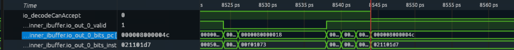

| 信号（`F.inner_ibuffer`） | 图1读数 |
|---|---|
| `io_out_0_valid` | 1 |
| `io_out_0_bits_pc` | `0x8000004c` |
| `io_out_0_bits_instr` | `0x021101d7` |
| `io_decodeCanAccept` | 0 |

约8544～8545处，槽0有效呈现目标PC和机器码；后端推进控制为0，目标在IBuffer输出等待。

**图2：IBuffer输出与Decode输入对应。**

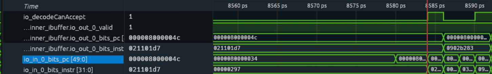

| 图2观察项 | 读数 |
|---|---|
| `F.inner_ibuffer.io_decodeCanAccept` | 1 |
| IBuffer输出槽0的PC、instr | `0x8000004c / 0x021101d7` |
| Decode输入槽0的PC、instr | `0x8000004c / 0x021101d7` |

约8584～8585处，全局推进条件满足，Decode输入出现与前端一致的目标字段。[CtrlBlock.scala](../stage1/reference/XiangShan/src/main/scala/xiangshan/backend/CtrlBlock.scala) 在前端与Decode间设置缓冲并选择输入来源，因此图中Decode可先处理更老指令，再接入当前前端输出。两图确认目标已由前端送达后端译码输入。

### 1.2.5 译码：识别vadd并生成向量微操作

观察 `B.inner_ctrlBlock.decode.io_out_0` 的valid/ready、PC、instr、fuType、fuOpType、vecWen、rfWen、逻辑源/目的编号、向量控制和微操作数量。[VecDecoder.scala](../stage1/reference/XiangShan/src/main/scala/xiangshan/backend/decode/VecDecoder.scala) 将 `VADD_VV` 映射到 `FuType.vialuF` 和 `VialuFixType.vadd_vv`；[DecodeStage.scala](../stage1/reference/XiangShan/src/main/scala/xiangshan/backend/decode/DecodeStage.scala) 组织微操作输出。

**图3：Decode槽0的有效译码输出。**

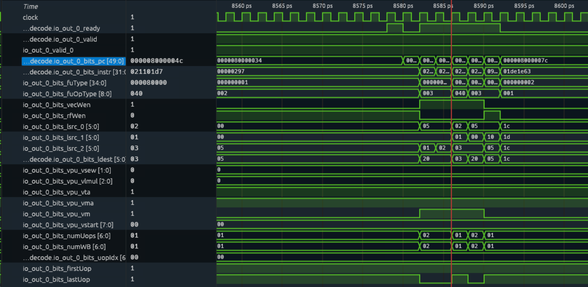

| 字段（`io_out_0`） | 图3读数 | 含义 |
|---|---|---|
| valid / ready | 1 / 1 | 输出有效且下游可接收 |
| bits_pc / bits_instr | `8000004c / 021101d7` | 目标指令 |
| bits_fuType / bits_fuOpType | `80000 / 040` | 向量整数类型、vadd_vv |
| bits_vecWen / bits_rfWen | 1 / 0 | 写向量目的，不写整数目的 |
| bits_lsrc_0 / 1 / 2 | `02 / 01 / 03` | vs1=v2、vs2=v1、旧vd=v3 |
| bits_ldest | `03` | 逻辑目的v3 |
| bits_vpu_vsew / vlmul | `0 / 0` | e8 / m1编码 |
| bits_vpu_vta / vma / vm | 1 / 1 / 1 | ta / ma / 无掩码 |
| bits_vpu_vstart | `00` | 从元素0开始 |
| bits_numUops / numWB / uopIdx | `01 / 01 / 00` | 一个微操作、一个完成计数、序号0 |
| bits_firstUop / lastUop | 1 / 1 | 同时为首、末微操作 |

约8586处，译码输出身份与目标一致，全部控制字段随有效微操作传递。`fuType=0x80000` 是[FuType.scala](../stage1/reference/XiangShan/src/main/scala/xiangshan/backend/fu/FuType.scala) 中vialuF的独热编码；`fuOpType=0x040` 对应[yunsuan的vadd_vv内部编码](../stage1/reference/XiangShan/yunsuan/src/main/scala/yunsuan/package.scala)。本条指令以一个向量微操作进入后端，四个活跃元素不拆成四条标量加法。vecWen表示后续写回控制，实际写请求在1.2.10观察。

### 1.2.6 重命名：分配物理寄存器与ROB身份

观察 `B.inner_ctrlBlock.rename.io_out_0` 的valid/ready、PC、instr、ldest、psrc_0/1、pdest、robIdx和uopIdx。[Rename.scala](../stage1/reference/XiangShan/src/main/scala/xiangshan/backend/rename/Rename.scala) 查询源寄存器映射，为目的分配新物理寄存器，并携带ROB编号。

**图4：Rename槽0的重命名结果。**

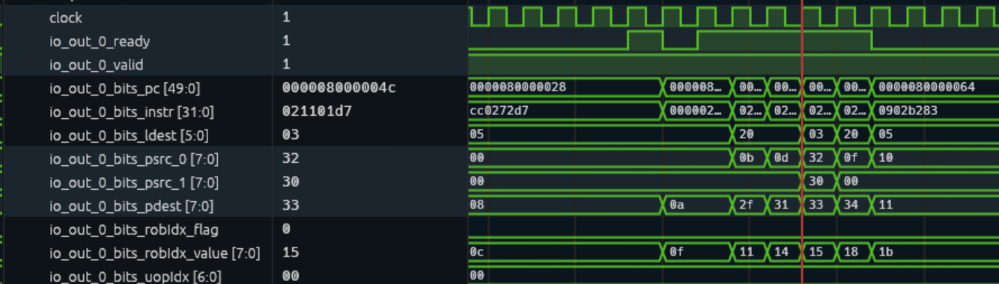

| 字段（`io_out_0`） | 图4读数 | 含义 |
|---|---|---|
| valid / ready | 1 / 1 | 有效输出且下游可接收 |
| bits_pc / bits_instr | `8000004c / 021101d7` | 目标身份保持一致 |
| bits_ldest | `03` | 逻辑目的v3 |
| bits_psrc_0 / bits_psrc_1 | `32 / 30` | v2映射至物理50，v1映射至物理48 |
| bits_pdest | `33` | 为v3分配物理51 |
| bits_robIdx_flag / value | `0 / 15` | ROB身份(0,21) |
| bits_uopIdx | `00` | 第0个微操作 |

重命名将逻辑寄存器关系转换为物理依赖：源为物理50和48，新目的为物理51。后续以 **ROB=(0,0x15)、pdest=0x33** 关联同一目标。psrc和pdest是寄存器编号，不是加法输入值。图4未显示时间刻度，原始VCD记录的该有效窗口约为8588；[CtrlBlock.scala](../stage1/reference/XiangShan/src/main/scala/xiangshan/backend/CtrlBlock.scala) 将Decode槽0经级间寄存连接至Rename槽0。

### 1.2.7 分发：送入向量队列并登记ROB

观察 `B.inner_ctrlBlock.dispatch.io_fromRename_0`、`io_toIssueQueues_16`，以及 `B.inner_vfScheduler.IssueQueueVfmaVialuFixVfalu.io_enq_0` 的有效/接收条件和身份字段；再观察 `B.inner_ctrlBlock.rob.io_enq_req_0` 与 `io_enq_canAccept`。[NewDispatch.scala](../stage1/reference/XiangShan/src/main/scala/xiangshan/backend/dispatch/NewDispatch.scala) 按功能类型分配队列入口，并发送ROB登记请求。

**图5(a)：分发输入、输出端口16与向量队列入队口0。**

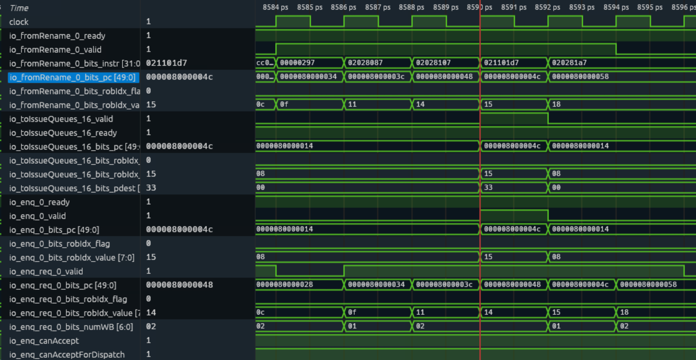

| 接口 | 图5(a)读数（约8590） |
|---|---|
| `dispatch.io_fromRename_0` | valid=ready=1；PC=`8000004c`、instr=`021101d7`、ROB=`(0,15)` |
| `dispatch.io_toIssueQueues_16` | valid=ready=1；PC=`8000004c`、ROB=`(0,15)`、pdest=`33` |
| `IssueQueueVfmaVialuFixVfalu.io_enq_0` | valid=ready=1；PC=`8000004c`、ROB=`(0,15)` |

三组接口身份一致，确认目标进入支持vadd的向量队列。16是分发模块的统一输出端口编号，0是该向量队列的本地入队端口编号。

**图5(b)：ROB入队口0登记目标。**

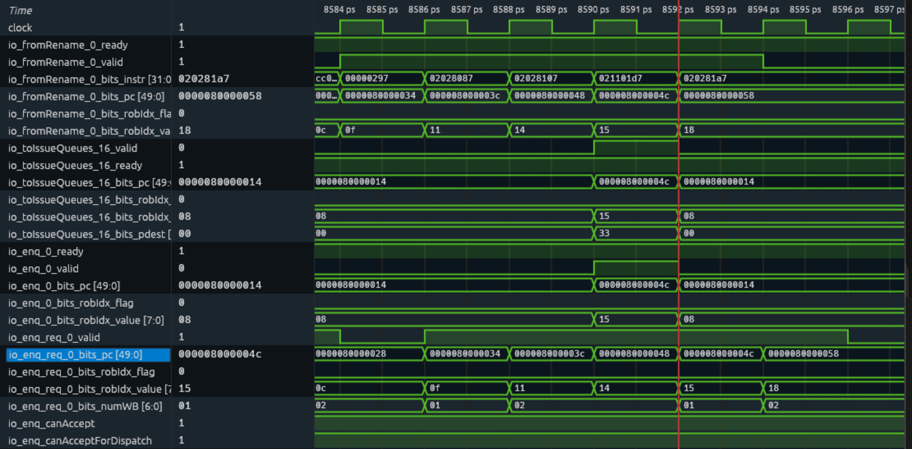

| 信号（`B.inner_ctrlBlock.rob`） | 图5(b)读数（约8592） |
|---|---|
| `io_enq_req_0_valid` | 1 |
| `io_enq_req_0_bits_pc` | `8000004c` |
| `io_enq_req_0_bits_robIdx_flag/value` | `0 / 15` |
| `io_enq_req_0_bits_numWB` | `01` |
| `io_enq_canAccept / io_enq_canAcceptForDispatch` | 1 / 1 |

ROB请求有效且可接收，目标以索引0x15登记，等待一个完成写回计数。[CtrlBlock.scala](../stage1/reference/XiangShan/src/main/scala/xiangshan/backend/CtrlBlock.scala) 对分发至ROB的请求寄存一级，因此队列入队窗口约8590，ROB请求窗口约8592。图5(b)的队列入队valid已降为0，表明当前有效窗口已经转移至后续接口。

### 1.2.8 发射：目标从队列进入执行路径

观察 `B.inner_vfScheduler.IssueQueueVfmaVialuFixVfalu.io_deqDelay_0` 的valid/ready和 `bits_common` 中的ROB、pdest、fuType、fuOpType、vecWen、isFirstIssue、iqIdx；同时观察 `B.inner_vfExuBlock.exus_2.io_in` 的有效条件与身份。[IssueQueue.scala](../stage1/reference/XiangShan/src/main/scala/xiangshan/backend/issue/IssueQueue.scala) 完成队列选择和出队，[DataPath.scala](../stage1/reference/XiangShan/src/main/scala/xiangshan/backend/datapath/DataPath.scala) 向执行单元提供数据。

**图6(a)：队列出队口0发射目标。**

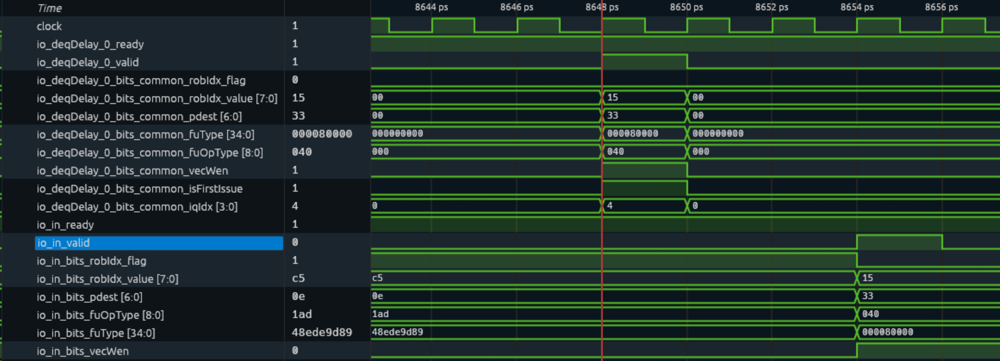

| 字段（`io_deqDelay_0`） | 图6(a)读数（约8648） |
|---|---|
| valid / ready | 1 / 1 |
| bits_common_robIdx_flag/value | `0 / 15` |
| bits_common_pdest | `33` |
| bits_common_fuType / fuOpType | `80000 / 040` |
| bits_common_vecWen / isFirstIssue | 1 / 1 |
| bits_common_iqIdx | `4` |

目标从队列项4通过出队口0发射，isFirstIssue=1表明本次为首次发射。

**图6(b)：目标到达执行单元exus_2。**

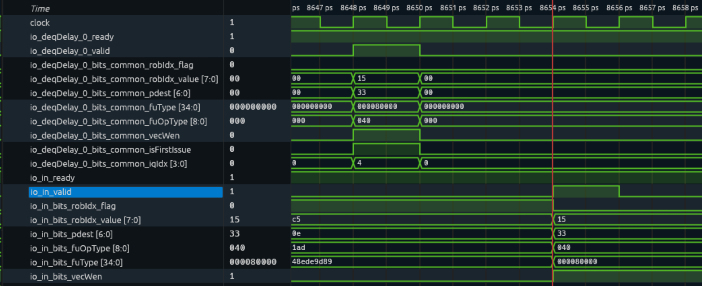

| 字段（`B.inner_vfExuBlock.exus_2.io_in`） | 图6(b)读数（约8654） |
|---|---|
| valid / ready | 1 / 1 |
| bits_robIdx_flag/value | `0 / 15` |
| bits_pdest | `33` |
| bits_fuType / fuOpType | `80000 / 040` |
| bits_vecWen | 1 |

执行输入与队列出口的ROB、物理目的和操作类型一致，确认同一目标已进入执行路径。两处有效窗口起点相差约3个仿真时钟周期；队列入队到发射期间存在等待，但本实验不进一步拆分各源或资源的等待原因。

### 1.2.9 执行：完成四个8位加法并处理尾部

观察 `B.inner_vfExuBlock.exus_2.VialuFix` 的输入有效条件、操作类型、向量控制、两个源数据，以及输出有效条件、ROB、pdest和结果；在其 `mgu` 子模块观察VL、vstart、ta/ma、eew、vdIdx、active和vd。[wrapper/VIAluFix.scala](../stage1/reference/XiangShan/src/main/scala/xiangshan/backend/fu/wrapper/VIAluFix.scala) 调用向量整数ALU，[Mgu.scala](../stage1/reference/XiangShan/src/main/scala/xiangshan/backend/fu/vector/Mgu.scala) 合并活跃元素和尾部。

**图7(a)：VialuFix有效输入。**

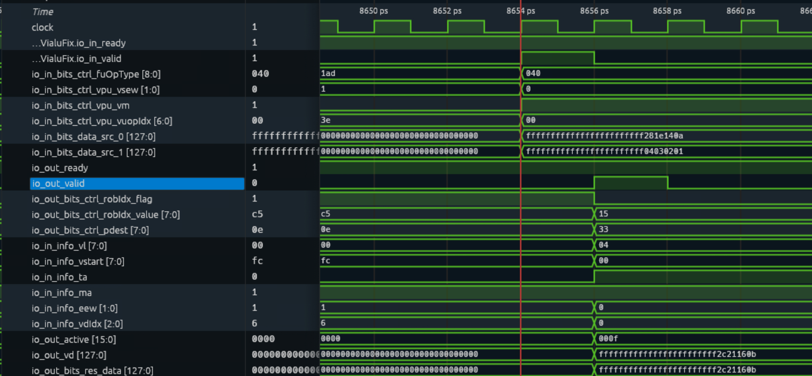

| 字段（`VialuFix`） | 图7(a)读数（约8654） |
|---|---|
| io_in_valid / ready | 1 / 1 |
| io_in_bits_ctrl_fuOpType | `040` |
| io_in_bits_ctrl_vpu_vsew / vm / vuopIdx | `0 / 1 / 00` |
| io_in_bits_data_src_0 | `ffffffffffffffffffffffff281e140a` |
| io_in_bits_data_src_1 | `ffffffffffffffffffffffff04030201` |

源0对应vs1=v2，低四元素为10、20、30、40；源1对应vs2=v1，低四元素为1、2、3、4。无掩码、e8和微操作序号0均与译码记录一致。

**图7(b)：VL4配置与有效计算结果。**

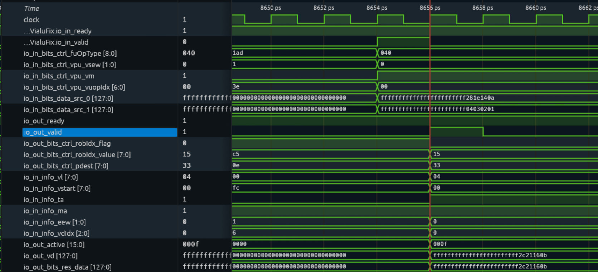

| 字段（`VialuFix`及其mgu） | 图7(b)读数（约8656） |
|---|---|
| io_out_valid / ready | 1 / 1 |
| io_out_bits_ctrl_robIdx_flag/value / pdest | `0 / 15 / 33` |
| mgu.io_in_info_vl / vstart | `04 / 00` |
| mgu.io_in_info_ta / ma / eew / vdIdx | `1 / 1 / 0 / 0` |
| mgu.io_out_active | `000f` |
| mgu.io_out_vd | `ffffffffffffffffffffffff2c21160b` |
| io_out_bits_res_data | `ffffffffffffffffffffffff2c21160b` |

VL=4、active=0x000f确认前四个字节活跃，结果低32位 `0x2c21160b` 按元素0到3对应11、22、33、44。尾部高96位置为全1，符合本实现的ta处理。Mgu输出与FU最终结果一致，输出ROB和pdest保持目标身份。

[FuConfig.scala](../stage1/reference/XiangShan/src/main/scala/xiangshan/backend/fu/FuConfig.scala) 中VialuCfg配置为128位输出、`CertainLatency(1)`；图7的输入、输出有效窗口起点约相差一个仿真时钟周期。该结果尚需通过后续写回和提交接口完成处理。

### 1.2.10 写回：产生向量写请求并向ROB报告完成

观察 `B.inner_wbDataPath.io_fromVfExu_1_0` 的valid、ROB、pdest、vecWen和data_0，`io_toVfPreg_1` 的wen、vecWen、addr和data，以及 `B.inner_ctrlBlock.rob.io_exuWriteback_15` 的valid、ROB索引和数据。[WbArbiter.scala](../stage1/reference/XiangShan/src/main/scala/xiangshan/backend/datapath/WbArbiter.scala) 将执行结果送往写请求和控制通路。

**图8(a)：写回入口与向量物理寄存器写请求。**

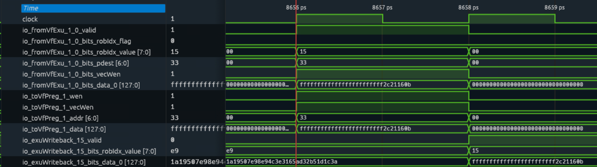

| 字段（`B.inner_wbDataPath`） | 图8(a)读数（约8656） |
|---|---|
| io_fromVfExu_1_0_valid | 1 |
| io_fromVfExu_1_0_bits_robIdx_flag/value | `0 / 15` |
| io_fromVfExu_1_0_bits_pdest / vecWen | `33 / 1` |
| io_fromVfExu_1_0_bits_data_0 | `ffffffffffffffffffffffff2c21160b` |
| io_toVfPreg_1_wen / vecWen | 1 / 1 |
| io_toVfPreg_1_addr | `33` |
| io_toVfPreg_1_data | `ffffffffffffffffffffffff2c21160b` |

结果与FU输出一致，写请求地址0x33与目标pdest相同，确认结果送往为逻辑v3分配的物理寄存器51。本节以写请求接口为观察边界；[DataPath.scala](../stage1/reference/XiangShan/src/main/scala/xiangshan/backend/datapath/DataPath.scala) 内部还对地址、数据和使能寄存后送入寄存器文件，不展开阵列内部写入。

**图8(b)：ROB执行完成通知。**

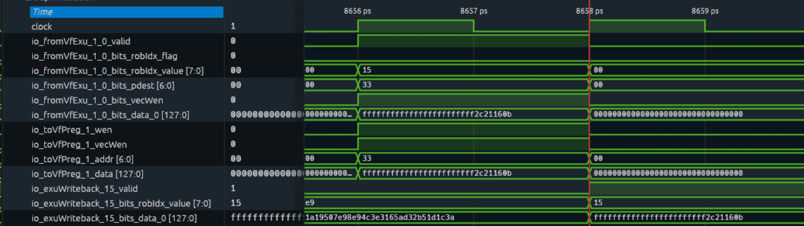

| 字段（`B.inner_ctrlBlock.rob`） | 图8(b)读数（约8658） |
|---|---|
| io_exuWriteback_15_valid | 1 |
| io_exuWriteback_15_bits_robIdx_value | `15` |
| io_exuWriteback_15_bits_data_0 | `ffffffffffffffffffffffff2c21160b` |

完成通知的ROB索引和数据与图8(a)对应。[CtrlBlock.scala](../stage1/reference/XiangShan/src/main/scala/xiangshan/backend/CtrlBlock.scala) 对写回信息寄存一级，因此写请求窗口约8656，ROB通知窗口约8658。图8(b)的前级写请求已经结束，不影响目标的完成通知继续传递；完成通知与正常提交分别观察。

### 1.2.11 提交：ROB按程序顺序退休目标

观察 `B.inner_ctrlBlock.rob` 的 `io_commits_isCommit`、`io_commits_commitValid_0`、`io_commits_robIdx_0_flag/value`、`io_commits_info_0_debug_ldest/pdest` 和 `io_commits_isWalk/walkValid_0`。[Rob.scala](../stage1/reference/XiangShan/src/main/scala/xiangshan/backend/rob/Rob.scala) 根据执行完成状态、程序顺序和阻塞条件产生正常提交资格。

**图9：提交槽0的目标有效窗口。**

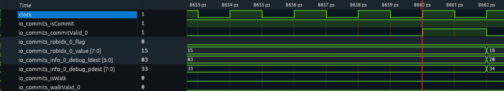

| 信号 | 图9读数（约8660） |
|---|---|
| io_commits_isCommit | 1 |
| io_commits_commitValid_0 | 1 |
| io_commits_robIdx_0_flag/value | `0 / 15` |
| io_commits_info_0_debug_ldest/pdest | `03 / 33` |
| io_commits_isWalk / io_commits_walkValid_0 | 0 / 0 |

约8660～8662的窗口中，正常提交模式、槽0有效和目标ROB匹配同时成立，逻辑目的v3与物理目的0x33也保持一致，确认本条向量加法获得正常退休资格，并在相应上升沿完成提交。

至此，结果低四元素11、22、33、44已通过执行输出、写请求、ROB完成通知和正常提交形成连续证据，完成本条指令的生命周期记录。

### 1.2.12 操作与原始记录

在已设置 `PROJECT`、`XS_ENV_ROOT` 和 `EMU` 的同一终端执行：

```bash
cd "$PROJECT"
WAVE=1 BEGIN=0 END=5000 bash stage1/vector-add/run.sh 00_vl4_ta
```

构建使用 [Makefile](../stage1/vector-add/Makefile) 和 [link.ld](../stage1/vector-add/link.ld)；[run.sh](../stage1/vector-add/run.sh) 保存程序镜像、反汇编、执行命令、环境记录、自检结果和VCD。2026-11-04 16:25:44开始的本次运行，其退出与自检记录为：

```text
HIT GOOD TRAP at pc = 0x800000b8
instrCnt = 62, cycleCnt = 4416
emu_exit_code=0
self_check=PASS
```

| 原始证据 | 文件 |
|---|---|
| 环境和emu标识 | [environment.log](../stage1/vector-add/runs/20261104-162544-706508-00_vl4_ta/environment.log) |
| 实际运行命令 | [command.txt](../stage1/vector-add/runs/20261104-162544-706508-00_vl4_ta/command.txt) |
| 仿真摘要与自检 | [summary.txt](../stage1/vector-add/runs/20261104-162544-706508-00_vl4_ta/summary.txt)、[result.txt](../stage1/vector-add/runs/20261104-162544-706508-00_vl4_ta/result.txt) |
| 程序身份 | [反汇编](../stage1/vector-add/runs/20261104-162544-706508-00_vl4_ta/00_vl4_ta.dis)、[镜像哈希](../stage1/vector-add/runs/20261104-162544-706508-00_vl4_ta/artifacts.sha256) |
| 本次原始波形 | wave.vcd（本地生成，不随包提交），本地文件约822 MiB |
| 波形截图 | [13张截图](../stage1/images/vector-add-vl4/)，此前采集，用于八阶段流程说明 |

程序总周期包含启动、输入加载、结果自检和退出，不作为单条vadd延迟。图中时间对应此前所附截图的接口有效窗口；最新功能运行结果与本次VCD以上表链接为准。

### 1.2.13 实验结果汇总

| 阶段 | 实测接口 | VCD时间附近（ps） | 关键证据 |
|---|---|---:|---|
| 取指 | IBuffer输出槽0 → Decode输入槽0 | 8544～8545、8584～8585 | PC=`8000004c`，instr=`021101d7` |
| 译码 | Decode输出槽0 | 8586 | fuType=`80000`，fuOpType=`040`，单微操作 |
| 重命名 | Rename输出槽0 | 8588，原始VCD记录 | psrc=`32/30`，pdest=`33`，ROB=`(0,15)` |
| 分发 | 输出端口16 → 向量队列入队口0；ROB入队口0 | 8590、8592 | 目标身份一致，numWB=1 |
| 发射 | 向量队列出队口0 → exus_2输入 | 8648、8654 | ROB=`(0,15)`，pdest=`33`，首次发射 |
| 执行 | exus_2.VialuFix及Mgu | 8654、8656 | VL=4，active=`000f`，结果低32位=`2c21160b` |
| 写回 | fromVfExu_1_0 → toVfPreg_1；ROB完成口15 | 8656、8658 | 写地址=`33`，结果与FU输出一致 |
| 提交 | ROB提交槽0 | 8660～8662 | isCommit=1、commitValid_0=1、ROB=`(0,15)` |

本次实测表明：在VLEN=128、SEW=8、LMUL=1、VL=4配置下，一条无掩码vadd以一个向量微操作完成前四个元素的相加，得到11、22、33、44，并经物理目的0x33写回、以ROB身份(0,0x15)正常提交。程序自检通过，八阶段的身份和数据对应一致。
