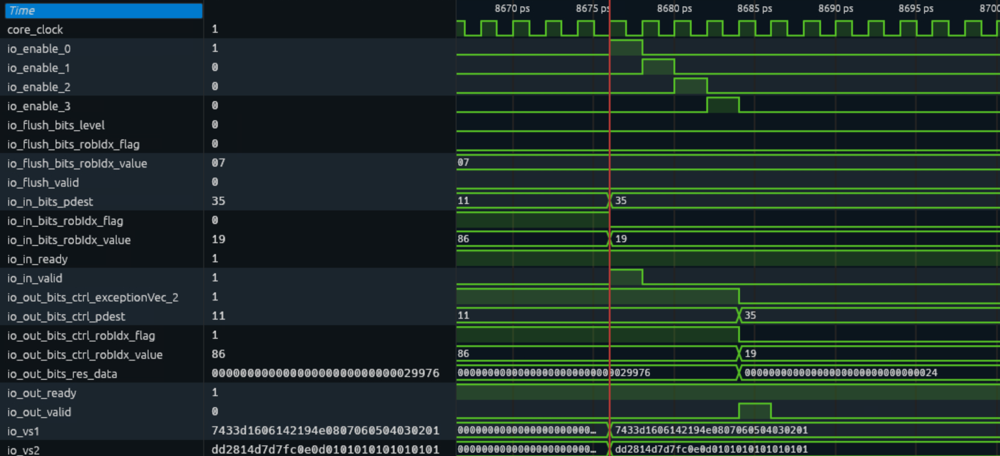
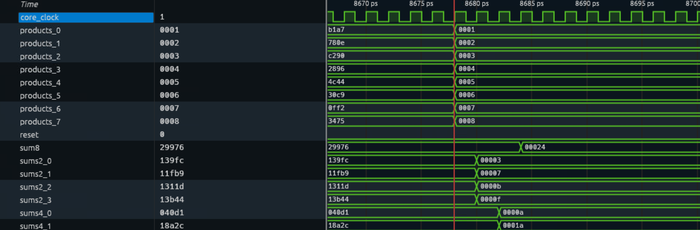
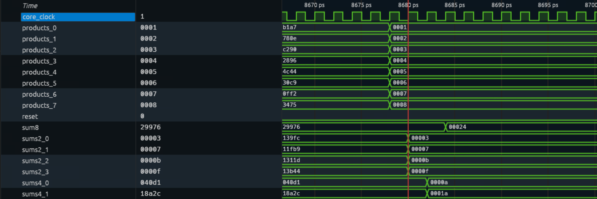
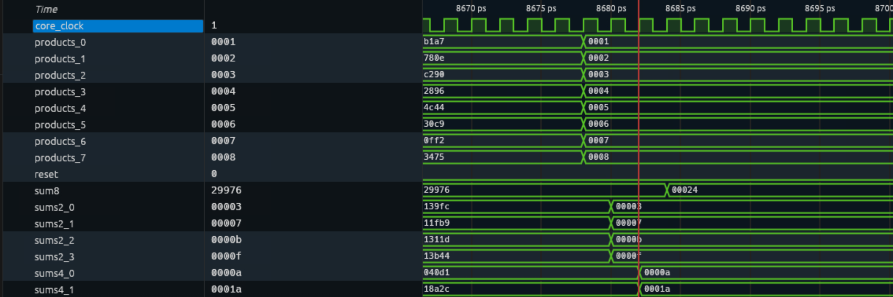
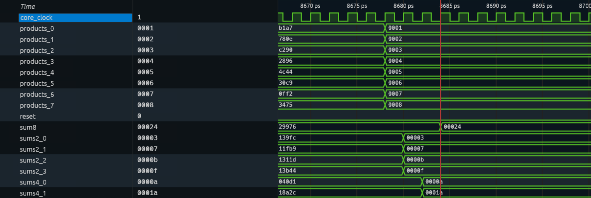

# 第三阶段：NEMU协同仿真与性能分析

本文对应3.1.1 NEMU扩展、3.1.2协同仿真、3.2 RVV组合基线和3.3延迟加速分析。硬件沿用当前stage2的四级流水、VFEX0单套vdot设计，新增功能参考与验证，不重复修改或接入另一套硬件。

## 1. 环境、代码与材料结构

本阶段复用stage2已构建的 `KunminghuV2Config` emu，重新构建NEMU参考共享库。NEMU基线为 `af9d4ce51fc2087156b09f26d64a8e1cfb83332f`。

| 目录 | 内容 |
|---|---|
| [3.1.1_NEMU](../stage3/3.1.1_NEMU/README.md) | 5个修改源码、接入补丁、参考配置、boot及模型测试 |
| [3.1.2_协同仿真](../stage3/3.1.2_协同仿真/README.md) | 8组功能套件源码及验证报告 |
| [3.2_RVV基线](../stage3/3.2_RVV基线/README.md) | 等价性程序、6个性能程序与生成器 |
| [3.3_延迟分析](../stage3/3.3_延迟分析/实验分析报告.md) | 当前设计的测量方法及实测分析 |
| [hardware](../stage3/hardware/README.md) | 与stage2一致的硬件源码材料副本 |

运行命令统一见[stage3 README](../stage3/README.md)。Git仓库保留源码、测试程序、实测结果汇总和截图。讲解视频单独提交，文件说明见 [视频交付说明](../videos/README.md)。stage3原始日志、镜像、VCD与复现目录不提交，按命令在本地results目录重新生成。

## 2. NEMU功能参考实现

参考模型使用与RTL一致的编码 `match=0xfe000057`、`mask=0xfe00707f`，限制e8/m1/VL8、vstart=0、vm=1。对两个源低8字节计算有符号点积，写入目的低32位，高96位清零。

| NEMU文件 | 改动 |
|---|---|
| isa-all-instr.h | 注册vdot执行helper |
| rvv/decode.h | 在OPIVV路径匹配自定义编码 |
| rvv/vcompute.h | 合法性检查、独立C循环点积及完整目的写入 |
| system/intr.c | 对齐当前机器态VL非法后端路径的mtval行为 |
| riscv64-xs-kmhv2-vdot-ref_defconfig | 固定与昆明湖V2匹配的参考配置和NMIE复位状态 |

`def_EHelper(vdot)`先检查配置，再将字节值128～255减256解释为负数，用int32累加8个乘积。全部读取后才清空目的并写入 `_32[0]`，保证源/目的重叠及v0使用正确；结束时清vstart并更新向量脏状态。非法配置在目的写入前触发异常。

DUT和REF使用同一 `boot.bin`。完整源码说明见[NEMU接入说明](../stage3/3.1.1_NEMU/接入说明.md)。NEMU模拟功能，不模拟四级RTL时序。

## 3. 模型测试与整核协同验证

### 3.1 NEMU独立模型测试

[模型测试程序](../stage3/3.1.1_NEMU/tests/nemu_model_test.c)直接加载真实共享库，通过DiffTest API设置状态、写入机器码、执行指令并读回结果。2026-11-04重新构建参考库后，1100组合法与7种非法配置均通过，复现后查看results/nemu-model-test.log。

合法样本检查完整128位目的、非目的向量寄存器不被污染，以及向量配置和脏状态。非法样本覆盖VL0、VL7、e16、m2、vstart1、VS关闭和vm0，核对mcause、mepc、mtval及目的仍为预置值。这是参考模型测试，不计入下面15项整核数量。

### 3.2 实际DiffTest机制与通过条件

每项命令显式指定 `--diff <参考库>` 与统一 `--flash boot.bin`，由RTL提交驱动参考模型并比较已启用的架构状态，包含向量寄存器和向量CSR。

验收要求：退出码0，日志出现 `Difftest enabled.`、`HIT GOOD TRAP`，且没有BAD TRAP/ABORT。结果JSON保存镜像及完整日志哈希、提交指令数与核心周期；独立核验逐项比对这些记录。

### 3.3 8项功能套件实测

| 套件 | 覆盖内容 | 提交指令数 | 核心周期 | 判定 |
|---|---|---:|---:|---|
| 00_smoke | 正数点积及完整目的结果 | 166 | 4515 | PASS |
| 01_directed | 10组定向输入、负数、极值及高位干扰 | 1507 | 7501 | PASS |
| 02_random | 128组固定种子的随机样本 | 19089 | 39212 | PASS |
| 03_alias_v0 | 9种源/目的重叠、同源及v0组合 | 1349 | 7002 | PASS |
| 04_pipeline | 独立流水、RAW依赖、目的覆盖及vadd交互 | 2829 | 9015 | PASS |
| 05_redirect | 分支恢复与错误路径架构状态检查 | 5041 | 8327 | PASS |
| 06_illegal | VL7、e16、m2、vstart1和vm0 | 105 | 4869 | PASS |
| 07_vadd | 既有向量加法回归 | 167 | 4510 | PASS |

另外1项 `rvv_equivalence`验证42组样本，本次6779条指令、18218周期；6项性能程序分别执行1、32、128次RVV或vdot。因此正常整核DiffTest总数为 **8＋1＋6＝15项，全部实际重新运行并通过**，执行镜像15/15与既有实测镜像逐字节一致。详情见[协同仿真报告](../stage3/3.1.2_协同仿真/验证报告.md)；原始独立核验文件不随包提交。


## 4. 已有RVV指令组合基线

基线入口为e8/m1/VL8、tu/mu，源v1/v2，v6预先准备为完整零向量：

```asm
vmv1r.v     v3, v6
vwmul.vv    v4, v1, v2
vsetivli    zero, 8, e16, m2, tu, mu
vwredsum.vs v3, v4, v6
vsetivli    zero, 8, e8, m1, tu, mu
```

五条指令依次完成完整目的清零、有符号8→16位宽化乘法、切换16位乘积解释、16→32位宽化归约及配置恢复。tu保留已清零的目标其余部分，最终完整128位结果与vdot语义一致。

实际序列在[generate.py](../stage3/3.2_RVV基线/generate.py)的BASE中，[program.py](../stage3/3.2_RVV基线/program.py)提供独立软件golden。42组样本包含10组定向与32组随机，等价性程序执行RVV组合后逐字节比较golden；vdot由功能套件验证，不将其描述为每个样本都在同一程序直接运行两种实现互比。

此基线允许使用临时寄存器，每次调用恢复e8/m1/VL8。

## 5. 性能测量与加速结果

性能程序分别执行1、32、128次点积，两边使用相同硬件、输入、启动、配置准备、循环控制和最终自检。vdot主体每轮1条，RVV主体每轮5条。输入重复使用固定v1/v2，不构成跨迭代点积结果的RAW链。

取RTL仿真器 `cycleCnt`，包含启动ROM、输入加载、配置、循环、自检和退出。定义：

```text
加速比 S = C_RVV / C_vdot
周期减少 R = (C_RVV - C_vdot) / C_RVV
```

| 点积次数 | 提交指令数vdot / RVV | vdot周期 | RVV周期 | 节省周期 | 加速比 | 周期减少 |
|---|---|---:|---:|---:|---:|---:|
| 1 | 174 / 178 | 4549 | 4571 | 22 | 1.0048× | 0.48% |
| 32 | 267 / 395 | 4653 | 5034 | 381 | 1.0819× | 7.57% |
| 128 | 555 / 1067 | 4797 | 6378 | 1581 | 1.3296× | 24.79% |

128次点积节省1581周期，端到端加速比为 **1.3296×**，总周期减少 **24.79%**。表格为2026-11-04实测汇总。复现后，results/runs中的各bench_*目录生成实际镜像、命令和完整压缩日志，report.py生成同批性能表。

单次程序中启动和检查开销占比大，重复次数增加后组合指令的开销更明显。乱序处理器可以重叠执行工作，所以5条对1条不意味着5倍性能。数据是固定输入裸机程序的核心周期，不是主机耗时、NEMU执行时间。

## 6. 实际波形与延迟含义

### 6.1 波形来源与整体计算

本节5张截图来自2026-11-04同次开启DiffTest的00_smoke。既有审计核对1笔输入/输出和15次算术寄存器更新。原始VCD、摘要和事务CSV不随包提交；可按stage3 README重新导出和审计。

```text
输入低8字节： [1,2,3,4,5,6,7,8] 与 [1,1,1,1,1,1,1,1]
products：    [1,2,3,4,5,6,7,8]
sums2：       [3,7,11,15]
sums4：       [10,26]
sum8：        36
完整128位输出：0x00000000000000000000000000000024
```

### 6.2 图1：输入vs1、vs2与事务身份

以下5张原始截图保存在 `stage3/images/`，按输入、乘法和三层加法顺序解读。截图中的总线读数采用十六进制，逐图数值已与现有VCD核对。



图1显示输入窗口中的 `io_in_valid=1`、`io_in_ready=1` 和第一级使能 `io_enable_0=1`，说明输入具备被接收并进入乘法流水的条件。

| 信号 | 图中读数 | 解读 |
|---|---|---|
| io_vs1 | `0x7433d1606142194e0807060504030201` | 低64位按最低字节起为[1,2,3,4,5,6,7,8] |
| io_vs2 | `0xdd2814d7d7fc0e0d0101010101010101` | 低64位为8个1 |
| io_in_bits_robIdx_flag/value | `0 / 0x19` | 完整ROB身份为(0,25) |
| io_in_bits_pdest | `0x35` | 目的物理寄存器编号53，不是架构v35 |
| io_flush_valid | 0 | 此输入窗口没有有效重定向冲刷 |

两个源的高64位包含非零数据，但不参与本指令。预期结果为 `1+2+3+4+5+6+7+8=36`。图中红线处 `io_out_valid=0`，此时输出侧旧ROB、异常位和旧数据尚不属于本笔有效输出；不能把旧的 `exceptionVec_2=1`解释成本笔非法，也不能把旧结果0x29976解释成本笔计算错误。

### 6.3 图2：S1八路并行乘法



图2红线附近可见 `products_0…7`依次更新为：

```text
十六进制：[0001,0002,0003,0004,0005,0006,0007,0008]
十进制：  [1,2,3,4,5,6,7,8]
```

这对应8路有符号字节乘法 `1×1`到`8×1`。按原VCD，8678 tick上升沿之后S1寄存器形成这些乘积，每项16位。此时sums2、sums4与sum8仍可能显示此前寄存器残留值；它们将由后续各级使能逐级更新，不要求同一拍全部变为最终结果。

### 6.4 图3：S2第一层加法，8项合并为4项



图3中 `sums2_0…3`分别为 `00003`、`00007`、`0000b`、`0000f`：

| 寄存器 | 运算 | 十进制结果 |
|---|---|---:|
| sums2_0 | products_0 + products_1 = 1+2 | 3 |
| sums2_1 | products_2 + products_3 = 3+4 | 7 |
| sums2_2 | products_4 + products_5 = 5+6 | 11 |
| sums2_3 | products_6 + products_7 = 7+8 | 15 |

原VCD中这些值在8680 tick上升沿后形成。每项17位，代码使用 `+&`保留加法增长位。图中的0x0b和0x0f分别是十进制11和15。

### 6.5 图4：S3第二层加法，4项合并为2项



图4中 `sums4_0=0x0000a`、`sums4_1=0x0001a`，即：

```text
sums4_0 = sums2_0 + sums2_1 = 3 + 7 = 10
sums4_1 = sums2_2 + sums2_3 = 11 + 15 = 26
```

原VCD中两项在8682 tick上升沿后形成，每项18位。八个乘积已经归并为两个四项和；此时sum8仍可保持旧值，直到最后一级更新。

### 6.6 图5：S4最终加法，得到点积36



图5中 `sum8=0x00024`，即 `10+26=36`，在8684 tick上升沿后形成。sum8为19位有符号数，随后符号扩展为32位，再与高96位零拼接，完整输出为：

```text
0x00000000000000000000000000000024
```

回看图1右侧，输出数据也变为0x24，`io_out_valid`出现有效脉冲，输出ROB和pdest更新为本笔的0x19与0x35，构成输入身份、逐级算术和输出结果的对应关系。FU输出仍需经过既有写回及提交路径，不能直接等同于ROB已提交。

### 6.7 四级延迟与观察边界

该笔ROB value为25、pdest为53，输入/输出采样时间为8678→8686，核心周期编号4339→4343。每周期2个VCD tick，因此FU延迟为4核心周期。审计采用上升沿前状态；波形界面跳变后的寄存器值属于沿后显示。


## 7. 复现步骤与结果查看

已按stage2准备四级vdot emu后，在新终端执行以下入口即可。完整依赖、版本与脚本说明见[stage3 README](../stage3/README.md)。

```bash
export PROJECT="$HOME/risc-v-compitition-26/cie2026-跳水-xiangshan-vdot"
export XS_ENV_ROOT="$(realpath "$PROJECT/../xs-env")"
cd "$PROJECT"
source "$XS_ENV_ROOT/env.sh"
python3 scripts/prepare.py --apply
python3 scripts/capture-emu.py
JOBS=12 bash scripts/build-nemu.sh
python3 scripts/run.py --all --wave
python3 scripts/report.py
```

`--all`执行15项；`--wave`只为00_smoke生成VCD。新批次输出到 `results/runs/<时间>/`，其 `results.json`保存整批统计和身份，每项 `result.json`保存判定，`emu.log.gz`为完整执行依据。性能表由report.py验证该批日志和镜像后产生。

本报告汇总2026-11-04完整实测，不附原始日志或复现目录。关键二进制身份记录如下：

| 对象 | SHA256 |
|---|---|
| 当前DUT emu | `131b822363cb8372737f00755fa60538cd968dacdd0de9892e4ffbd77adb86df` |
| NEMU参考共享库 | `c843264fed8335d3661c09d15f087068fa10b09a26c263ced7619c542ea21cfe` |

新复现的源码/构建身份保存在results/captured-emu.json，DUT、REF、boot及逐项结果保存在results/runs/<时间>/results.json。以上均为本地产物，不随包提交。
